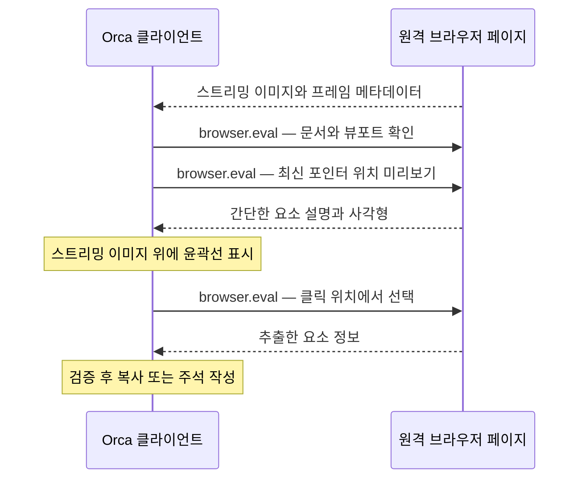

# 원격 브라우저 요소 선택

[English](remote-browser-element-selection-implementation.md)

서버 화면을 스트리밍하는 브라우저 창에서 이제 **페이지 요소 가져오기(Grab page element)**와 **페이지 요소 주석 달기(Annotate page element)**를 사용할 수 있습니다. 이전에는 원격 도구 모음에 주석 기능을 사용할 수 없다고 표시되었고, 이미지 위에 그림을 그리는 기능은 있었지만 요소 선택은 지원하지 않았습니다. 이제 원격 호스트에서 실행 중인 페이지의 요소 정보를 가져와 기존 복사, 주석 카드, 트레이, 에이전트 전달 흐름을 사용합니다. 선택 클릭은 페이지의 버튼이나 링크를 실행하지 않으며, 선택 중에도 휠로 스크롤할 수 있습니다.

이 구현은 기존 작업 공간 범위의 `browser.eval` 요청으로 호스트의 **현재 DOM**을 조회합니다. 표시 중인 JPEG를 생성했던 시점의 DOM을 복원하지는 않습니다. [창 통합 코드](../../src/renderer/src/components/browser-pane/stream-remote/use-remote-browser-page-element-tools.ts)는 활성 상태이고 사용 가능한 스트리밍 페이지에서만 선택기를 켜며, 이미지 마크업과 요소 선택을 동시에 실행하지 않습니다.

[좌표 조회](../../src/shared/browser-grab/remote-grab-point-script.ts)는 세 가지 작업으로 나뉩니다. **Probe**는 문서 식별값, CSS 뷰포트, 루트 스크롤 위치를 얻으며 페이지의 window에 작은 식별 속성을 기록합니다. **Preview**는 `document.elementFromPoint`로 요소를 찾고 태그, 역할, 길이가 제한된 텍스트, 사각형만 반환합니다. **Select**는 클릭 위치의 요소를 별도로 확인하고 공통 요소 추출기를 실행합니다. 이 평가들은 페이지에 오버레이나 지속적인 입력 리스너를 설치하지 않으며 선택 클릭도 보내지 않습니다. 결과는 객체 또는 JSON으로 인코딩된 객체로 받을 수 있고, 디코더가 구조를 검사합니다.

[미리보기 세션](../../src/renderer/src/components/browser-pane/stream-remote/remote-browser-grab-session.ts)은 처리 중인 미리보기 요청 하나와 대기 중인 최신 포인터 위치 하나만 유지합니다. 이전 포인터 위치는 교체하며, 오래된 응답은 윤곽선을 다시 그릴 수 없습니다. [스케줄러](../../src/renderer/src/components/browser-pane/stream-remote/remote-browser-grab-pacing.ts)는 미리보기 시작 사이에 최소 50ms를 두고, 측정한 요청 지연과 변동에 따라 짧은 대기 시간을 추가합니다. 포인터가 24ms 동안 멈추면 추가 대기를 줄입니다. 측정에는 호스트 평가 시간도 포함됩니다. 클릭하면 대기 중인 미리보기를 지우고, 진행 중인 미리보기 응답을 기다리지 않은 채 별도의 선택 요청을 보냅니다. 호버 결과가 클릭 대상을 결정하지 않으며, 실패하거나 시간 초과된 미리보기를 무조건 재시도하지 않습니다.

[클라이언트 오버레이](../../src/renderer/src/components/browser-pane/stream-remote/remote-browser-grab-overlay.tsx)는 선택용 누름과 뗌을 처리하고, 반환된 사각형을 로컬에 그리며, Escape로 취소할 수 있게 합니다. 따라서 원격 페이지에 그린 윤곽선이 다음 이미지로 돌아올 때까지 기다릴 필요가 없습니다. 휠 이벤트는 [기존 원격 휠 처리 경로](../../src/renderer/src/components/browser-pane/stream-remote/use-remote-browser-page-wheel.ts)로 전달하며, 이 경로가 원격 포인터를 옮기고 누적 스크롤 값을 보냅니다. 스크롤을 전달하기 전에 미리보기를 무효화합니다.

이미 오래되었다고 판단할 수 있는 결과는 다음 검사로 차단합니다.

- [좌표 변환](../../src/renderer/src/components/browser-pane/stream-remote/remote-browser-grab-geometry.ts)은 화면에 표시된 프레임의 위치를 호스트가 알려 준 CSS 뷰포트 좌표로 바꿉니다. 프레임 밖의 좌표는 거부합니다. 호스트는 요소를 찾는 동일한 평가 안에서 문서 식별값과 뷰포트를 검사합니다. 선택 시에는 프레임 메타데이터에 루트 스크롤이 있으면 이 값도 검사하며, 오차 허용 범위는 2픽셀입니다.
- [크기·위치 관찰 코드](../../src/renderer/src/components/browser-pane/stream-remote/use-remote-browser-grab-geometry-fence.ts)는 창이나 프레임의 크기, 스크롤, 배율이 바뀌면 미리보기를 지웁니다. 선택 요청 도중 이러한 변화가 생기면 요소 정보를 수락하지 않고 위치가 바뀌었다는 결과를 반환합니다. 표시된 프레임과 스크롤 위치가 다른 윤곽선은 숨깁니다. 크기·위치 변화가 없는 이미지 갱신만으로 미리보기를 무효화하지는 않습니다.
- [선택기 훅](../../src/renderer/src/components/browser-pane/stream-remote/use-remote-browser-grab-mode.ts)과 기존 작업 토큰은 페이지, 창, 환경 또는 작업 세대가 교체된 뒤 도착한 결과를 거부합니다. 탐색, 새로고침, 연결 해제 또는 창을 사용할 수 없는 상태가 되면 세션을 종료합니다. 같은 범위로 돌아와도 사용자가 다시 시작하기 전까지 취소 상태를 유지합니다. 취소는 로컬에서 처리하며, 미리보기 요청 제한 시간은 10초, 문서 확인·선택 요청은 15초, 선택기 유효 시간은 120초입니다.

선택은 로컬 선택기와 같은 [공통 추출 스크립트](../../src/shared/browser-grab/grab-guest-content-script.ts)와 [반환 데이터 검증](../../src/shared/browser-grab/browser-grab-payload.ts)을 사용합니다. 기존 필드 크기 제한, 속성 필터링, URL 쿼리·프래그먼트 제거, 비밀값 패턴 가림을 유지하며 HTML 조각에서도 입력값을 제거합니다. 요소 정보에는 선택자, 접근성 이름, HTML, 크기, 스타일, 주변 DOM, 확인 가능한 React 컴포넌트 정보가 포함될 수 있습니다. 이 정책이 임의의 페이지 텍스트에 민감한 정보가 전혀 없음을 보장하지는 않습니다. 기존 주석 흐름이 검증된 데이터를 사용하고, [공통 오버레이 좌표 계산](../../src/renderer/src/components/browser-pane/describe-page/browser-annotation-geometry.ts)이 표시된 페이지 크기에 맞춰 카드를 배치합니다. 스트리밍 스크롤 메타데이터도 카드 위치에 반영합니다.

스트림의 최신 상태 유지는 DOM 조회와 별도로 처리합니다. [데스크톱 구독](../../src/renderer/src/components/browser-pane/stream-remote/remote-browser-screencast-subscription.ts)은 `everyNthFrame: 1`, `minFrameIntervalMs: 33`을 요청하여 정적인 페이지의 유일한 갱신을 샘플링으로 건너뛰지 않게 합니다. [호스트 프레임 전송 제어](../../src/main/browser/browser-screencast-frame-pacer.ts)는 최신 대기 프레임을 유지하며, 이제 `sessionId`가 같아도 교체되는 각 프레임 이벤트에 수신 확인(ACK)을 보냅니다. ID가 재사용되어도 교체된 이벤트의 ACK 의무가 사라지는 것은 아닙니다. 이 방식은 제한된 전송 주기와 마지막 프레임 전달을 유지합니다. 33ms는 전송 간격 목표이지 프레임률이나 지연 보장이 아니며, ACK도 클라이언트가 이미지를 표시했다는 증명은 아닙니다.

이 방식은 선택 전용 RPC나 스트림 opcode를 추가하지 않고 기존 평가·스트리밍 전송을 재사용합니다. JPEG마다 전체 DOM을 스냅샷으로 보내면 일반 스트리밍에도 추출 작업과 전송량이 늘어나므로 그렇게 구현하지 않았습니다. 고정 이미지와 그에 대응하는 요소 맵을 함께 제공하는 방식은 **아직 구현하지 않은 제안**입니다. 현재 DOM 조회와 스트리밍 이미지는 원자적으로 묶인 쌍이 아니므로, 이미지 캡처와 평가 사이에 DOM이 바뀌면 대상도 달라질 수 있습니다. 스크롤 메타데이터가 없으면 해당 검사가 약해지며, 최상위 문서의 요소 조회만으로 iframe 내부, shadow root 내부, canvas에 그린 객체의 일반적 지원을 보장하지 않습니다. 기존 요청 필드를 사용해 프로토콜 변경을 줄였지만, 모든 이전 버전과의 호환성을 증명한 것은 아닙니다.

빌드 지원에는 WSL의 Podman을 사용하는 [로컬 Linux ARM64 패키징 경로](../../config/scripts/build-linux-arm64-local.ps1)가 포함됩니다. JavaScript 단계와 ARM64 네이티브·패키징 단계를 분리하고, 고정된 빌드 입력과 기존 네이티브 호환성 검사를 사용합니다. [Wayland 보조 프로그램 빌더](../../config/scripts/build-wayland-clipboard.mjs)는 Docker와 Podman을 지원합니다. [패키징 설정](../../config/electron-builder.config.cjs)은 `.tmp` 임시 작업 디렉터리가 앱 리소스에 포함되지 않도록 제외합니다. 사용자 테스트 실행기 수정은 로컬 테스트 기반 도구의 수정이며, 커밋할 제품 동작에 포함되지 않습니다.

최종 `1.4.229-remote-picker.4` 후보의 기록된 검증 결과는 **관련 회귀 테스트 89/89 통과**, 전체 `pnpm tc` 통과, 변경 코드 품질 보고서 7종 모두 신규 지적 0건입니다. Windows 패키지 테스트는 **2/2**를 통과했습니다. Windows x64 클라이언트와 같은 버전의 네이티브 Linux ARM64 호스트 조합에서 일반 폴더와 Git 작업 공간 모두 통과했습니다. 결과는 **3.9분에 2/2**, 작업 공간별 검사 25개 성공, 이미지 6개 검토입니다. 요소 정보, 주석, 클릭 차단, 앱 UI 확대, 스크롤·마지막 프레임 갱신, 새로고침, 클라이언트 연결 해제·재연결을 확인했습니다. Linux 패키지 감사에서는 네이티브 바이너리 21개를 지원 데스크톱 호환성 기준과 대조했습니다.

사용자는 후보가 동작하는 것으로 보인다고 알리고 PR 업데이트를 요청했습니다. 이는 수동 체크리스트의 모든 사례를 완료했다는 의미는 아닙니다. 서로 다른 버전 조합, WAN·네트워크 장애 동작, 실제 OS 클립보드 전달, 네이티브 데스크톱 포커스는 자동 검증하지 않았습니다. SSH 포워딩을 거친 페어링 테스트가 직접 SSH 브라우저 릴레이 작업 공간이나 모든 클라이언트 플랫폼을 검증한 것도 아닙니다. 이는 기록된 증거의 범위이며, 보편적 호환성을 주장하지 않습니다.
