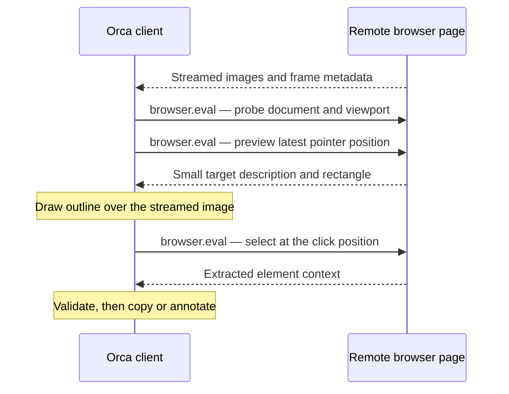

# Remote browser element selection

[한국어](remote-browser-element-selection-implementation.ko.md)

Server-streamed browser panes now offer **Grab page element** and **Annotate page element**. Previously, the remote toolbar showed annotations as unavailable; image markup was available, but element selection was not. A selection now returns context from the page running on the remote host, then uses Orca's existing copy, annotation card, tray, and agent-delivery flow. Selection clicks do not activate the page's button or link. Wheel scrolling remains available while selecting.

The implementation queries the host's **current DOM** through the existing workspace-scoped `browser.eval` request. It does not reconstruct the DOM that produced a displayed JPEG. The [pane integration](../../src/renderer/src/components/browser-pane/stream-remote/use-remote-browser-page-element-tools.ts) enables the picker only for an active, available streamed page and keeps image markup and element selection mutually exclusive.

The [point query](../../src/shared/browser-grab/remote-grab-point-script.ts) has three operations. **Probe** obtains a document identity, CSS viewport, and root scroll position; it records a small identity property on the page's window. **Preview** uses `document.elementFromPoint` and returns only the tag, role, bounded text, and rectangle. **Select** independently hit-tests the click position and runs the shared element extractor. These evaluations install no guest overlay or persistent input listeners and dispatch no selection click. Results may arrive as an object or a JSON-encoded object; the decoder checks their shape.

The [preview session](../../src/renderer/src/components/browser-pane/stream-remote/remote-browser-grab-session.ts) holds at most one preview request in flight and one latest pending pointer position. Older pointer positions are replaced, and obsolete answers cannot repaint the outline. The [scheduler](../../src/renderer/src/components/browser-pane/stream-remote/remote-browser-grab-pacing.ts) enforces a 50 ms minimum between preview starts, adds a short delay based on measured request latency and variation, and shortens that delay once the pointer rests for 24 ms. The estimate includes host evaluation time. A click clears queued previews and sends its own selection request without waiting for an outstanding preview; hover results never decide the clicked target. Failed or timed-out preview work is not blindly retried.

The [client overlay](../../src/renderer/src/components/browser-pane/stream-remote/remote-browser-grab-overlay.tsx) captures selection presses and releases, draws the returned rectangle locally, and supports Escape cancellation. This avoids waiting for a guest-painted outline to travel back in another image. It forwards wheel events through the [existing remote wheel path](../../src/renderer/src/components/browser-pane/stream-remote/use-remote-browser-page-wheel.ts), which moves the remote pointer and sends the accumulated scroll delta. Scrolling invalidates the preview first.

Several checks prevent known stale results from being used:

- [Coordinate mapping](../../src/renderer/src/components/browser-pane/stream-remote/remote-browser-grab-geometry.ts) converts the displayed frame's position into the host's CSS viewport, using the viewport reported by the host. Points outside the frame are rejected. The host checks document identity and viewport in the same evaluation as the hit test; selection also checks root scroll when frame metadata supplies it, with a two-pixel tolerance.
- The [geometry observer](../../src/renderer/src/components/browser-pane/stream-remote/use-remote-browser-grab-geometry-fence.ts) clears previews when the pane or frame geometry changes, including scroll and scale. A geometry change during selection returns a moved result instead of accepting the payload. Outlines are hidden when their scroll position disagrees with the displayed frame. An image update with unchanged geometry does not by itself invalidate a preview.
- The [picker hook](../../src/renderer/src/components/browser-pane/stream-remote/use-remote-browser-grab-mode.ts) and existing operation tokens reject late work for a replaced page, pane, environment, or operation generation. Navigation, reload, disconnect, or pane unavailability retires the session. Returning to the same scope keeps it cancelled until the user starts again. Cancellation is local; preview requests have a 10-second timeout, probe/selection requests have a 15-second timeout, and the picker has a 120-second lease.

Selection reuses the [shared extraction scripts](../../src/shared/browser-grab/grab-guest-content-script.ts) and [payload validation](../../src/shared/browser-grab/browser-grab-payload.ts) used by the local picker. They retain the existing field budgets, attribute filtering, URL query/fragment removal, and secret-pattern redaction, including removal of input values from HTML snippets. Context can include the selector, accessible name, HTML, dimensions, styles, surrounding DOM, and available React component information. This policy is not a guarantee that arbitrary page text contains no sensitive information. The existing annotation flow consumes the validated payload; [shared overlay geometry](../../src/renderer/src/components/browser-pane/describe-page/browser-annotation-geometry.ts) scales cards to the displayed page, and streamed scroll metadata updates their placement.

Stream freshness is handled separately from DOM queries. The [desktop subscription](../../src/renderer/src/components/browser-pane/stream-remote/remote-browser-screencast-subscription.ts) requests `everyNthFrame: 1` and `minFrameIntervalMs: 33`, so sampling does not skip a static page's only update. The [host frame pacer](../../src/main/browser/browser-screencast-frame-pacer.ts) retains the newest pending frame and now acknowledges every replaced frame event, including events with the same `sessionId`. Reusing an ID does not erase the replaced event's acknowledgement credit. This preserves bounded pacing and final-frame delivery; 33 ms is a pacing target, not a frame-rate or latency guarantee, and an acknowledgement does not prove that a client painted the image.

This approach reuses the existing evaluation and streaming transport without adding a picker RPC or stream opcode. It avoids a full DOM snapshot for every JPEG, which would add extraction work and data transfer to ordinary streaming. A frozen image with a matching element map remains an **unimplemented proposal**. Current queries and streamed images are not an atomic pair: DOM changes between image capture and evaluation can still change the target. Missing scroll metadata weakens that check, and the top-document hit test does not establish general support for iframe contents, shadow-root internals, or canvas-drawn objects. Existing request fields reduce protocol changes; they do not prove compatibility with every older peer.

Build support includes a [local Linux ARM64 packaging route](../../config/scripts/build-linux-arm64-local.ps1) using Podman in WSL, separate JavaScript and ARM64 native/package stages, pinned build inputs, and the existing native compatibility gates. The [Wayland helper builder](../../config/scripts/build-wayland-clipboard.mjs) accepts Docker or Podman. [Packaging configuration](../../config/electron-builder.config.cjs) excludes `.tmp` staging directories from application resources. The user-test launcher repair was local test infrastructure, not committed product behavior.

Recorded verification for the final `1.4.229-remote-picker.4` candidate includes **89/89 related regression tests**, full `pnpm tc`, and zero new findings in all seven changed-code quality reports. Windows packaged tests passed **2/2**. A Windows x64 client paired with a same-version native Linux ARM64 host passed both plain-folder and Git workspace journeys: **2/2 in 3.9 minutes**, with 25 successful checks per workspace and six reviewed images. Coverage included element context, annotation, click suppression, application UI zoom, scroll/final-frame freshness, reload, and client disconnect/reconnect. The Linux package audit checked 21 native binaries against the supported desktop compatibility floor.

The user reports that the candidate appears to work and requested the PR update; this does not assert completion of every manual checklist case. Mixed-version peers, WAN/network-failure behavior, real OS clipboard delivery, and native desktop focus were not automated. The paired SSH-forwarded test does not establish direct SSH browser-relay workspace coverage or all client platforms. These are the limits of the recorded evidence, not a claim of universal compatibility.
